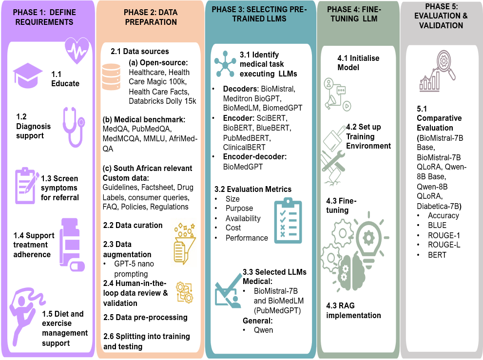
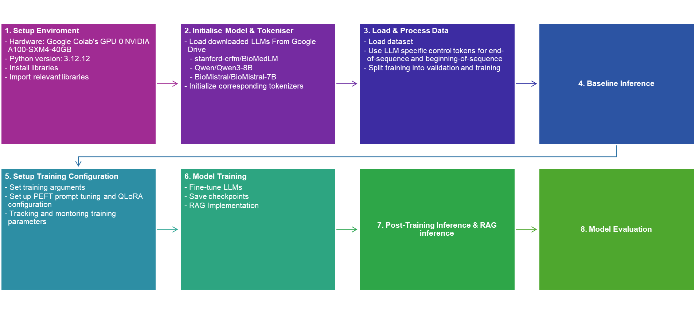

# A Domain-Specific Large Language Model for Diabetes Care and Management

Last updated: November 2025

## Table of contents 

1. [Project Description](#project-description) 
2. [Project Organization](#project-organization) 
3. [Getting Started](#getting-started)
4. [Authors](#authors)
5. [More Information](#more-information)

## Project Description 
-----------

This study was initiated to develop a domain-specific Large Language Model (LLM) aimed at improving diabetes care and management, addressing the unique challenges faced by South African patients, caregivers, and medical practitioners. To achieve this, local data was collected and supplemented with benchmark and medical Hugging Face datasets. Medical specialised BioMedLM (2.7B) and BioMistral-7B pre-trained LLMs were selected as base models, along with Qwen3-8B (a non-specialised LLM). Parameter-Efficient Fine-Tuning (PEFT) techniques, prompt tuning and Quantised Low-Rank Adaptation (QLoRA) were applied, with Retrieval-Augmented Generation (RAG) applied on the best-performing LLM. The fine-tuned LLMs were evaluated by comparing their respective performance with Diabetica-7B, a diabetes specialised model. 

The final collected dataset consisted of 18,079 processed question-answer pairs (14% of which were artificially generated to reflect the South African context), along with 1,596 documents. The data covered topics such as medication, management (diet and exercise), diagnosis and screening, and general diabetes-related content, ensuring comprehensiveness. When evaluating fill-in-the-blanks and multiple-choice question-answer pairs, Qwen QLoRA outperformed all LLMs, achieving ROUGE-1 of 0.793, ROUGE-L of 0.792, and BERT Score F1 of 0.940. However, Diabetica achieved a higher BLEU of 0.465, while Qwen3-8B. achieved a BLEU of 0.365. For multiple-choice questions only, Qwen3-7B LLMs performed consistently better, with Qwen3-7B QLoRA achieving the highest accuracy of 80.7%. For short and long answer questions, BioMistral-7B QLoRA showed slightly superior performance, with all LLMs performing above 0.800. The results of this study show promising applications of LLMs in healthcare. 

## Methodology 
This study adopted an experimental research design. The experimental research process is shown below, and consists of five phases. 

### Data Summary
Available datasets contains two format types. The documents in pdf format as follows:

And the question-answer pairs as follows with respective sources, as follows:

### Modelling Process

The modelling process followed is experimental with steps.

## Project Organization
------------

    ├── LICENSE
    ├── Makefile
    ├── README.md
    ├── data
    │   ├── raw           
    │   ├── processed
    │   └── extenal  
    ├── docs
    ├── models
    │   ├── archive
    │   ├── 01_GT_Functions.ipynb
    │   ├── 02_GT_FinalElephantIdentificationModel.ipynb
    │   ├── 03_GT_ValidateWithELPephantData.ipynb
    │   ├── TG_App.py
    │   └── yolo11n-seg.pt
    ├── notebooks
    │   ├── archive
    │   ├── 01_GT_ImageProcessing.ipynb
    │   ├── 02_GT_FeatureExtraction.ipynb
    │   ├── 03_GT_EvaluatingResults.ipynb
    ├── references
    ├── ├── References.text
    ├── reports
    │   ├── figures
    │   ├── 01_GT_Project_Scoping_Worksheet.pdf
    │   ├── 02_GT_Exploratory_Data_Analysis.pdf
    │   ├── 03_GT_Modelling_Report_MIT808t.pdf
    │   ├── 04_GT_Visualisation_Report_MIT808.pdf
    │   ├── 05_GT_Final_Report_MIT808 KDD.pdf
    │   ├── 06_GT_Poster_MIT808.pdf
    │   └── 07_GT_Presentation_MIT808.pdf
    ├── requirements.txt   <- The requirements file for reproducing the analysis environment, e.g.
    │                         generated with `pip freeze > requirements.txt`
    │
    ├── setup.py           <- makes project pip installable (pip install -e .) so src can be imported
    ├── src                <- Source code for use in this project.
    │   ├── __init__.py    <- Makes src a Python module
    │   ├── models         <- Scripts to train models and then use trained models to make
    │   │   ├── GT_FinalElephantIdentificationModel.ipynb
    │   └── visualization  <- Scripts to create exploratory and results oriented visualizations
    │       └── TG_App.py
    └── tox.ini            <- tox file with settings for running tox; see tox.testrun.org

    

--------

<small>Project based on the <a target="_blank" href="https://drivendata.github.io/cookiecutter-data-science/">cookiecutter data science project template</a>. #cookiecutterdatascience</small>

## Getting Started
-----------
### Prerequisites 

- Python 3.12.12
- Google Colab
- Google Drive

### Request Data Access: 

**Raw**: [African Savanna Elephant Images](https://drive.google.com/drive/folders/1tY1UGVq3MqqHQNtRMvCzg8Jd5DQd1ekd?usp=drive_link), Email Heinrich van Deventer <heinrich.vandeventer@up.ac.za>

**Processed**: [Processed Images and Features](https://drive.google.com/drive/folders/1SQljZdZshWlvMRVfzOAMalV3a9G5rkn4?usp=sharing)

**External**: Email Matthias Körschens <matthias.koerschens@uni-jena.de>  (Not required to run model)

### Usage of model- Load model directly

from transformers import AutoModel
model = AutoModel.from_pretrained("Gift-Z/UshukelaDiabetesLLM", dtype="auto")

## Authors 
-----------

* Written by : Gift Silinda
* Contact details : u13292057@tuks.co.za

## More Information 
---------

The project is run in Google Colab as the modeling steps require multi-process and the data is on google drive with limited access to the only developers

